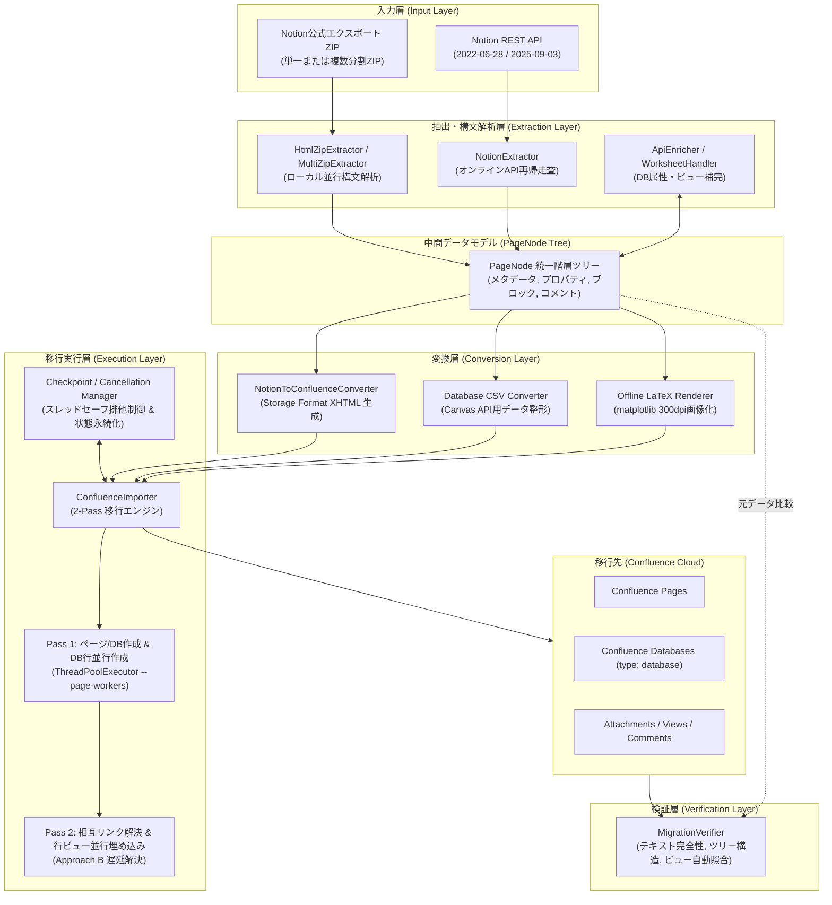
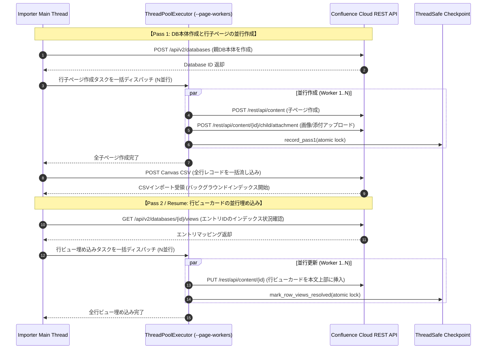
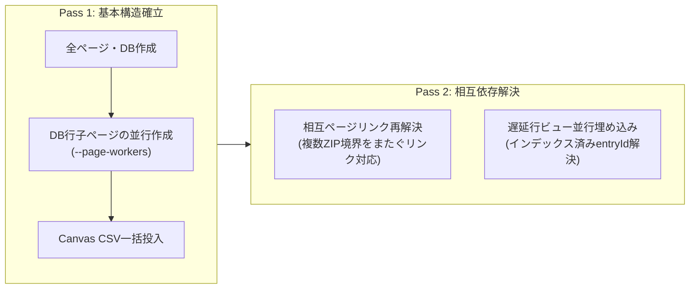

# Notion to Confluence 移行ツール 技術仕様書 (SPECIFICATION.md)

本ドキュメントは、NotionからConfluence Cloudへの移行ツールのシステムアーキテクチャ、並行処理設計、対応ページ要素の変換仕様、プラットフォーム差分に伴う制限事項、運用・耐障害性仕様、および自動整合性検証ツールの技術仕様を定義するものです。

---

## 1. システムアーキテクチャ概要

本移行ツールは、外部サードパーティサービスを介さず、ローカル環境で安全かつ高信頼に動作するパイプライン設計を採用しています。



### コアコンポーネント構成
1. **抽出モジュール (`src/html_extractor.py`, `src/extractor.py`)**:
   - `HtmlZipExtractor`: NotionエクスポートZIP（HTML/CSV）を直接解凍・解析。
   - `MultiZipExtractor`: 分割出力された複数ZIPをローカルスレッドで並行解凍・構文解析し、グローバルDBマップを共有した単一の統合PageNodeツリーを構築。
   - `NotionExtractor`: Notion REST APIを再帰走査し、最新のViews API（`2025-09-03`）からGroup by情報を含むビュー定義を取得。
2. **変換モジュール (`src/converter.py`)**:
   - Notionのブロック・プロパティ群をConfluence Storage Format（XHTML）およびConfluence Databases構築用CSVに変換。
   - 数式（LaTeX）をローカルPC環境で300dpi高解像度PNGに画像化。
3. **インポート・実行制御モジュール (`src/importer.py`, `src/checkpoint.py`, `src/cancellation.py`)**:
   - 2-Pass移行モデル（Pass 1: 作成、Pass 2: リンク・行ビュー解決）。
   - Confluence REST APIへの並行アクセス制御（`--page-workers`）。
   - シグナルトラップ（`SIGINT`/`SIGTERM`）による安全な中断と、チェックポイントからの差分レジューム再開。
4. **検証モジュール (`src/verifier.py`)**:
   - 移行完了後にConfluence REST APIからコンテンツを取得し、Notion元データとのテキスト網羅性、ツリー階層、マクロ正常性、DBビュー・行件数を自動照合。

---

## 2. 並行処理・非同期実行アーキテクチャ (Concurrency Specification)

本ツールでは、処理速度の最大化とConfluence Cloud APIの安定運用の両立を図るため、**「ローカルファイル解析における並行処理」** と **「Confluence REST APIに対する並行アクセス」** の双方でマルチスレッド並行処理を実装しています。

### 2.1 Confluence REST APIへの並行アクセス仕様

大規模Notion移行（特に数千〜数万件のレコードを持つデータベース移行）において、API呼び出しを直列に行うと膨大な時間を要します。本ツールは以下の箇所でConfluence APIへの並行アクセスを行います。



#### ① データベース行子ページの並行作成
* **対象**: データベースに属する各行レコードに対応する子ページ（`database_row`）群。
* **動作仕様**:
  - 親DB作成後、配下の全子ページ作成タスクを `concurrent.futures.ThreadPoolExecutor` に投入。
  - 各ワーカースレッド内で、Confluence REST API (`POST /rest/api/content`) の呼び出し、添付ファイル・カバー画像のアップロード、ページコメント登録を独立して実行。
  - 進捗状況および完了IDは、スレッドセーフなチェックポイントマネージャーへアトミックに逐次記録。
* **並行数制御**: コマンドライン引数 `--page-workers <count>` により指定（デフォルト: `8` 並行）。

#### ② 子ページへのデータベース行ビュー（Row View）・プロパティの折りたたみ埋め込み
* **対象**: Confluence Database のエントリ（`entryId`）がインデックスされた後の各子ページ本文更新、および本文なし/ありレコードの構造化。
* **動作仕様**:
  - **ページ最上部メタデータヘッダ（テンプレートカスタマイズ対応）**:
    - Notion側の作成者（ユーザーマッピング適用時は `@メンション` バッジ）、作成日時、最終更新日時（タイムゾーン考慮）をコンパクトなヘッダとして全ページ共通で自動配置。
    - コマンドライン引数 `--metadata-template <template_str_or_file>` により完全カスタマイズ可能（利用可能な変数: `{author}`, `{created_time}`, `{last_edited_time}`, `{last_edited_by}`, `{title}`, `{url}`）。
    - 空文字 `""` または `none` を指定した場合、ヘッダは一切出力されず完全非表示となります。
  - **親データベースへのナビゲーション**:
    - `📁 所属データベース: [DB名]` へのインラインリンクを配置。
  - **行ビューおよびプロパティの折りたたみマクロ格納**:
    - Confluence DB一覧から行リンクをクリックした際、右側プレビュー領域（サイドパネル）で開かれると行ビュー（スマートカード）が展開されず描画崩れを引き起こす現象を防止するため、**ネイティブ行ビューおよびプロパティ一覧テーブルは `<ac:structured-macro ac:name="expand">`（タイトル: `📋 レコードプロパティ・行編集 (クリックして展開)`）内に格納してデフォルト非展開（折りたたみ）** とします。
    - 単独ページとして開いた際には、ユーザーが展開してプロパティの双方向編集や確認を行うことが可能。
  - **本文エリア**:
    - Notion側にブロックが存在する場合は `<hr />` および `<h2>📄 レコード詳細本文</h2>` の下に展開。
    - 本文が存在しないレコード（`blocks == 0`）の場合は、余分なプレースホルダ文言や区切り線を出力せず、折りたたみプロパティの直後でクリーンに終了。

#### ③ Atlassian Cloud レートリミット（429 Too Many Requests）制御と安全性
* **API保護と安全マージン**:
  - Atlassian Cloudのテナント単位レートリミットを回避するため、デフォルト並行数を安全な `8` スレッドに設定。
  - 全APIクライアントに指数バックオフ付き自動リトライ機構（最大5回、`Retry-After` ヘッダー尊重）を搭載。
  - ユーザー環境の回線帯域やAtlassian契約プランに応じて `--page-workers` を 1〜16 の範囲でチューニング可能。

### 2.2 ローカル処理における並行処理仕様

* **複数分割ZIPの並行解凍・構文解析 (`MultiZipExtractor`)**:
  - 巨大なワークスペースから出力された複数のエクスポートZIP（`ExportBlock-*.zip`）を、ローカルのCPUスレッド（`ThreadPoolExecutor`）を用いて並行展開・解析。
  - 各ZIP内のHTML/CSV解析を並行化することで、100ページ規模の複数ブロックを 0.05 秒でメモリ上にパース完了。

### 2.3 階層ツリー（通常ドキュメントページ）の直列走査仕様

* **直列実行の理由**:
  - 通常のドキュメントページ（フォルダ階層構造を持つページ）は、**親ページがConfluence側で作成され、IDが確定しないと子ページの `parent_id` に指定できない** という厳密な親子依存関係を持ちます。
  - また、階層全体の深さ優先探索（DFS）を直列に進行させることで、APIの突発的なバーストアクセスを抑制し、安全確実にツリーを構築します。
* **将来拡張（計画）**:
  - 同一の親を持つ兄弟ノード群（同一階層の独立ページ）については、親ID確定後にバッチ並行作成を行う最適化が可能（後述）。

### 2.4 スレッドセーフティと排他制御仕様

* **チェックポイント排他制御 (`threading.RLock`)**:
  - 並行実行中のワーカースレッド群から `record_pass1`、`record_pass2`、`mark_row_views_resolved`、`save` が同時に呼び出されても内部データ破損や競合（Race Condition）が発生しないよう、再入可能ロック（`threading.RLock`）で完全保護。
  - ディスクへのチェックポイント書き出しは、アトミックな一時ファイル書き込み＋置換（`os.replace`）により整合性を担保。

---

## 3. 対応ページ要素・コンテンツ変換仕様 (Content Specifications)

Notionのブロック構造とConfluence Storage Format（XHTML）の完全対比表です。

### 3.1 リッチテキスト・インライン装飾

| Notion要素 | Confluence Storage Format | 仕様および変換動作 |
| :--- | :--- | :--- |
| **見出し 1〜3** (`heading_1`〜`3`) | `<h1>`〜`<h3>` | 完全対応。見出しアンカーを保持。 |
| **トグル見出し** (`is_toggleable`) | `<h1>`〜`<h3>` + `<ac:structured-macro ac:name="expand">` | Expandマクロ直下に見出しを展開し、折りたたみコンテナを配置。 |
| **文字装飾** (太字, 斜体, 下線, 取消線) | `<strong>`, `<em>`, `<u>`, `<s>` | 複合装飾（太字＋斜体＋下線など）も入れ子構造で完全維持。 |
| **インラインコード** (`code`) | `<code>...</code>` | 完全対応。特殊文字（`<`, `>`, `&`）はXMLエスケープ。 |
| **インライン数式** (`equation`) | `<code>...</code>` | 可読性維持のためコード形式で展開。 |
| **文字色・背景色** (`color`) | `<span style="color: ...; background-color: ...;">` | **【独自高機能】** Notionの全カラーパレットをConfluence CSS形式で忠実に再現。 |

### 3.2 リスト・トグル・引用構造

| Notion要素 | Confluence Storage Format | 仕様および変換動作 |
| :--- | :--- | :--- |
| **箇条書きリスト** (`bulleted_list_item`) | `<ul><li>...</li></ul>` | 連続する項目を単一のリスト要素に集約。 |
| **番号付きリスト** (`numbered_list_item`) | `<ol><li>...</li></ol>` | 連続する項目を単一のリスト要素に集約。 |
| **ToDoリスト** (`to_do`) | `<ac:task-list><ac:task>...` | Confluenceネイティブのタスクマクロ（完了/未完了チェックボックス）へ変換。 |
| **多段ネストリスト** | `<li>本文<ul><li>ネスト</li></ul></li>` | リスト種別をまたぐ多段ネスト（深さ制限なし）を正確に保持。 |
| **トグルブロック** (`toggle`) | `<ac:structured-macro ac:name="expand">` | タイトル付き折りたたみマクロに変換。内部の全ネストブロックも再帰保持。 |
| **引用ブロック** (`quote`) | `<blockquote><p>本文</p></blockquote>` | 引用枠内に段落、コード、リスト等のネストを完全内包。 |
| **コールアウト** (`callout`) | `<ac:structured-macro ac:name="info\|warning\|note\|tip">` | **【独自高機能】** 絵文字・背景色を解析し、Confluenceの4大情報マクロへインテリジェント自動分類。 |

### 3.3 メディア・添付ファイル・レイアウト

| Notion要素 | Confluence Storage Format | 仕様および変換動作 |
| :--- | :--- | :--- |
| **数式ブロック** (`equation`) | `<ac:image><ri:attachment ri:filename="equation_*.png" />` | **【独自高機能】** matplotlibにより300dpi高解像度PNGを完全オフライン生成し、添付・画像埋め込み。 |
| **画像** (`image`) | `<ac:image><ri:attachment ri:filename="*.png" />` | Notion署名付きURLまたはZIP内バイナリを永続添付ファイルとしてアップロードし、インライン埋め込み。 |
| **添付ファイル** (`file`, `pdf`) | `<ac:link><ri:attachment ... />` / `viewpdf` | 実体ファイルをConfluence添付ファイルとして登録し、`file`（HTML上 `data-notion-file` 付きのプレビューなしPDF含む）はダウンロードリンク、`pdf`（埋め込みPDF）は `viewpdf` マクロによるインライン埋め込みプレビューを配置。 |
| **カバー画像** (`cover`) | `<ac:image ac:align="center" ac:layout="full-width">` | カバー画像を取得し、中央50%（1200x200）でバナー比率にローカルクロップの上、最上部ヘッダーバナーとして配置。 |
| **マルチコラム（段組）** (`column_list`, `column`) | `<ac:structured-macro ac:name="section\|column">` | 2〜N段組のネイティブセクション・カラムマクロに変換。 |
| **目次** (`table_of_contents`) | `<ac:structured-macro ac:name="toc" />` | 見出し階層と完全連動するConfluenceネイティブTOCマクロを生成。 |
| **シンプルテーブル** (`table`, `table_row`) | `<table><thead>...<tbody>...</table>` | ヘッダー行指定を忠実に反映した標準テーブルとして出力。 |
| **Mermaid ダイアグラム** (`code: mermaid`) | `<ac:structured-macro ac:name="code">`<br>(`language: mermaid`) | **【完全閉域・依存ゼロ】** 外部API通信やローカルブラウザ（Playwright）のインストールを一切行わず、Confluenceネイティブのコードブロックマクロ（`language: mermaid`、タイトル・行番号付き）として直接出力。Confluence標準でエラーなく描画され、Mermaidアプリ導入環境とも完全連動。 |
| **受信リンク・バックリンク一覧** (`incoming-links`) | `<ac:structured-macro ac:name="expand">` (`🔗 このページへのリンク元`) | **【独自高機能】** Pass 2で全ノードの被参照リンク（ページ内リンク・メンション・リレーション）を自動解析し、リンク元のページ一覧（クリック可能な内部リンク）を各ページ最下部に自動配置。 |
| **ページコメント（最上位）** | Confluence REST API (`type: comment`) | Notion APIおよびHTML（`<details><summary>ページコメント</summary>`）から投稿者・投稿日時・本文を抽出し、Confluenceコメントとして登録。Confluence Cloud APIは監査ログ保護のため作成日時の外部上書きを許可しない仕様であるため、本文最上部に「💬 Notion元コメント — 発言者名 \| 🕒 元投稿日時 (タイムゾーン変換適用)」のメタデータヘッダーを明記して登録。 |

### 3.4 データベース・マルチビュー仕様

* **正規 Confluence Databases (`type: database`) の構築**:
  - 静的HTML表ではなく、Confluence Cloudの最新正規データベースオブジェクトを直接生成。
  - カラム型（単一選択 `status`/`select`、複数選択 `multi_select`、日付、テキスト、数値、リレーション等）を完全制御。
* **マルチビュー自動構築**:
  - Canvas メタデータ操作（`add_view`）により、テーブルビュー、ステータス別/優先度別ボードビュー（カンバン）、ギャラリービュー（カード）を自動プロビジョニング。
* **カレンダービュー (Calendar View) およびタイムラインビュー (Timeline View) の処理仕様**:
  - Confluence Databases のプラットフォーム制約（サポートされるレイアウトは `table`, `board`, `gallery` の3種類のみで、ネイティブなカレンダーレイアウトは未提供）に基づき、Notion側の `calendar` / `timeline` ビューは「**日付順にソートされたテーブルビュー（Table View）**」または「**ギャラリービュー（Gallery View）**」として作成・マッピング。
  - 人間確認用チェックシート (`--export-worksheet`) 上では `inferred_layout` に `table` が自動提案され、Notes欄に `Notion calendar ビュー (日付順テーブルとして作成)` と明記されるため、運用者の要望に応じて確認・レイアウト変更（`confirmed_layout`）が可能。
* **期間（開始日・終了日）を持つ日付カラム（Date Property Range）の処理仕様**:
  - Confluence Databasesの `date` カラム型は単一のISO日付（`YYYY-MM-DD`）のみを許容する仕様であるため、DBセル内には主軸となる「**開始日 (start)**」を `date` 型として格納（ソート・フィルタ・ボード軸の機能を維持）。
  - レコード各子ページ（ヘッダーのPage Propertiesマクロおよび本文）では、期間情報が一切欠落しないよう、`<time datetime="開始日" /> 〜 <time datetime="終了日" />` の形式で**開始日と終了日を完全に出力・保持**。
  - プロパティ値やメンションに時刻情報が含まれる場合は、指定されたタイムゾーン（例: `15:30 JST`）を自動付与して表示。
* **タイムゾーン（Timezone）指定と実行環境からの自動検出仕様**:
  - CLIオプション `--timezone <tz>` / `--tz <tz>`（例: `Asia/Tokyo`, `JST`, `UTC`）により、コメントや日時に適用するタイムゾーンを明示指定可能。
  - 未指定時は、ローカル実行環境（OS/Python環境の `datetime.now().astimezone().tzinfo` および `tzname()`）からデフォルトタイムゾーン（日本環境なら `JST`）を自動検出し、起動バナーおよび各種メタデータヘッダー（Notionコメント日時等）へ自動反映。
* **子ページへの編集可能な行ビュー（Row View）カード埋め込み**:
  - DBレコードの子ページ最上部に、親DBを開かずに直接プロパティ編集可能な行ビューカードを埋め込み配置。

### 3.5 プラットフォーム差分の近似対応と制限事項 (Parity Limitations)

1. **外部Web埋め込み (`embed`)**:
   - Confluence Cloudのセキュリティポリシー（CSP）により、未許可ドメインのiframe展開は行わず、Atlassian Smart Links（カード形式）または安全なハイパーリンクとして配置。
2. **同期ブロック (`synced_block`)**:
   - Confluenceにリアルタイム双方向同期ブロックが存在しないため、同期元ブロックの内容を各同期先ページへ静的に展開・配置（情報・レイアウト欠落ゼロ）。
3. **メンション記法 (`mention`)**:
   - 日付メンションは `<time datetime="YYYY-MM-DD" />` の固定日付バッジに変換（Notionの動的相対日付やリマインダー通知は非連動）。
   - ページメンションは内部ページリンク（`<ac:link>`）へ変換。
4. **Group by 表示**:
   - Confluence Databasesに単一ビュー内Group by機能がないため、Notionのグループ化設定に基づき、未完了グループは常時展開見出し＋完了グループは折りたたみExpandマクロのハイブリッド複数ビューとして近似移植。

---

## 4. 移行実行・運用・耐障害性仕様 (Operations & Resilience)

大規模移行（数千〜数万ページ）を安全・確実に完遂するための運用設計です。

### 4.1 2フェーズ移行モデル (2-Pass Migration Model)



1. **Pass 1 (基本エンティティ作成)**:
   - 全ページ、データベース、添付ファイル、およびDB行子ページを作成。
   - データベースへの初期Canvas CSV投入を完了。インデックス待ちは行わず高速にPass 1を完了。
2. **Pass 2 (相互参照・遅延要素の解決)**:
   - 全ページのConfluence IDが確定した状態で、ブロックをまたぐ相互ページリンクを正規の `<ac:link>` に再解決。
   - Confluence側でインデックス完了したDBエントリを検知し、各子ページへの行ビューカード埋め込みを並行更新。

### 4.2 レジューム機能 (Resume from Checkpoint)
* **アトミック逐次同期とロック競合耐性**: 1ページまたは1DBの作成・更新ごとに、同一ディレクトリ内の一意な一時ファイル（`tempfile.NamedTemporaryFile`）経由でコンパクト JSON として `migration_checkpoint.json` へアトミック保存（親ディレクトリ不在時は自動作成、POSIX環境のみ `chmod 0600` 適用）。Windows 環境の Defender/EDR やクラウド同期による一時的ロック競合（`PermissionError` / `[WinError 5]`・`[WinError 32]` 等）発生時は、`WARNING` ログを記録しつつ指数バックオフ＋ジッター付きで自動リトライします。
* **書込不能時の即時停止 (Fail-Fast)**: 全リトライ上限を超過する恒久的な書き込み障害時は、`ERROR` ログを記録した上で `CheckpointWriteError` を送出し、移行処理を即座に安全停止します（未記録のまま移行継続して `--resume` 時に重複作成することを防止）。
* **差分再開**: `--resume` オプションを指定することで、作成済みノードを自動スキップし、未処理のノードおよび中断されたPassのみを高速かつ安全に再開。
* **Windows 実地運用推奨**: Google Drive for desktop や OneDrive 等の同期対象フォルダ配下で大規模移行を実行すると同期クライアントによるファイルロック競合が多発するため、作業ディレクトリを非同期ローカルフォルダへ配置するか、`--checkpoint C:\temp\migration_checkpoint.json` のように同期対象外のローカルパスを指定することを推奨します。

### 4.3 安全な中断機能 (Graceful Cancellation)
* **シグナル捕捉**: `SIGINT` (Ctrl+C) および `SIGTERM` を検知。
* **クリーン終了保証**: 実行中の単一APIリクエスト完了を待機し、チェックポイントをディスクに完全フラッシュ保存した上で正常終了（終了コード0）。次回 `--resume` で完全に安全に再開可能。

### 4.4 大規模移行時の標準出力サマライズ表示
* **自動折りたたみ**: 移行ノード数が25件を超える場合、端末バッファの圧迫を防ぐため自動的にツリー統計サマリー表示へ切り替え。
* **検証結果サマリー**: PASSした数千ページのログは集約し、WARN（警告）またはFAIL（失敗）のノードのみをハイライト表示。
* **全件表示オプション**: 必要に応じて `--show-all-pages` または `--verbose` で全件展開が可能。

### 4.5 開発者向けサニタイズド報告ログ生成 (Debug Report / Telemetry)
* **機密情報の完全マスキング**: タイトル、本文、個人名、メールアドレス、API認証トークンをSHA-256ハッシュ化またはマスキング。
* **動作テレメトリの抽出**: ブロック種別遷移、マクロ分布、HTTPレスポンスコード分布、処理時間、未対応ブロック警告のみを抽出した `debug_report.json` / `debug_report.md` を出力（`--generate-debug-report`）。

### 4.6 DB属性・ビュー補完仕様
* **API Enrichment モード (`--enrich-via-api`)**: HTMLエクスポートから高速解析したツリーに対し、Notion API (`databases.retrieve`, `Views API`) をピンポイントで呼び出してDBプロパティ型スキーマとビュー属性を完全補完。
* **Worksheet モード (`--export-worksheet`, `--import-worksheet`)**: 完全オフライン閉域環境向けに、推測された全DBカラム・ビュー定義をExcel編集可能なCSV/JSONシートとして出力・人間が修正・再読込して反映。

---

## 5. 移行完了自動整合性検証仕様 (Migration Verifier)

移行完了後、Confluence REST APIからデータを直接取得し、Notion元データとの整合性を自動検証します（ブラウザ不要）。

### 5.1 通常ページの検証項目
1. **タイトル完全一致**: `node.title` と Confluence `title` の一致。
2. **親階層（ツリー構造）**: Confluenceの `ancestors` 末尾と期待される親IDの一致。
3. **マクロ・拡張機能エラー検知**: View HTML内のエラー文字列（`拡張機能の読み込み中にエラーが発生しました` 等）の有無。
4. **固有要素の存在**: 数式画像、コードマクロ、テーブル、チェックリスト、カバー画像、添付ファイルの存在確認。
5. **Notionテキスト網羅性**: Notionブロック内の主要テキスト（5文字以上）がConfluence本文中に欠落なく含まれているかの照合。

### 5.2 データベースの検証項目
1. **メタデータ検証**: タイトル、親ページID、ステータス（`current`）の一致。
2. **行エントリ件数の一致**: Notion側レコード件数とConfluence Databases API取得件数の照合。
3. **プロパティスキーマ網羅性**: 全カラム名およびデータ型の認識確認。
4. **ビュー設定照合**: テーブルビュー、ボードビュー（カンバン）、ギャラリービュー、Group byフィルタービューが過不足なく作成されているかの照合。

---

## 6. コマンドラインインターフェース (CLI Reference)

```bash
# 基本実行（単一または複数エクスポートZIPからの移行）
python migrate.py --zip export.zip --title-prefix "[Migrated] "

# 複数分割ZIP（移行ブロック）の一括並行解析と移行
python migrate.py --zip-dir ./notion_exports/ --page-workers 8

# 大規模DB並行処理および遅延行ビュー解決レジューム
python migrate.py --zip export.zip --page-workers 8 --resume

# 事前ドライラン（Confluenceへの送信を行わず解析結果のみ確認）
python migrate.py --zip export.zip --dry-run

# API併用ハイブリッドDB補完モード
python migrate.py --zip export.zip --enrich-via-api

# 人間確認用ワークシート出力 / 修正シート反映
python migrate.py --zip export.zip --export-worksheet schema_check.csv
python migrate.py --zip export.zip --import-worksheet schema_check.csv

# 開発者報告用サニタイズログ出力
python migrate.py --zip export.zip --generate-debug-report --debug-report-dir ./logs/

# 端末表示で全ページリストを強制展開
python migrate.py --zip export.zip --show-all-pages
```

### CLIオプション一覧

| オプション | 引数 | デフォルト値 | 説明 |
| :--- | :--- | :--- | :--- |
| `--zip` | `<path>` | `None` | Notion公式エクスポートZIPファイルのパス。 |
| `--zip-dir` | `<dir>` | `None` | 複数分割エクスポートZIPが格納されたディレクトリパス。 |
| `--title-prefix` | `<str>` | `""` | 移行先Confluenceページタイトルに付与する接頭辞。 |
| `--parent-id` | `<id>` | `None` | 移行先Confluence親ページID（省略時はスペースルート）。 |
| `--page-workers` | `<int>` | `8` | **Confluence APIへの並行アクセスワーカースレッド数**（DB行子ページ作成および行ビュー埋め込み）。 |
| `--resume` | なし | `False` | 中断されたチェックポイントから未完了ノード・Passを安全に再開。 |
| `--checkpoint` | `<path>` | `migration_checkpoint.json` | チェックポイントファイルの保存・読込パス。 |
| `--dry-run` | なし | `False` | Confluence APIを実行せず、抽出ツリー構造のみを検証・表示。 |
| `--enrich-via-api` | なし | `False` | Notion APIを併用してDBプロパティスキーマ・ビュー設定を高精度補完。 |
| `--export-worksheet` | `[path]` | `None` | DBカラム型・ビュー設定の人間確認用ワークシート（CSV/JSON）を出力。 |
| `--import-worksheet` | `<path>` | `None` | 人間が承認・修正したワークシートを読み込んでConfluenceへ反映。 |
| `--generate-debug-report` | なし | `False` | 機密情報をハッシュ化した開発者報告用サニタイズレポートを出力。 |
| `--debug-report-dir` | `<dir>` | `./debug_reports` | サニタイズレポートの出力先ディレクトリ。 |
| `--timezone`, `--tz` | `<tz>` | `None` (ローカル自動判定) | 時刻表示に使用するタイムゾーン (例: `Asia/Tokyo`, `JST`, `UTC`)。 |
| `--no-dashboard` | なし | `False` | Richインタラクティブ進捗ダッシュボードを無効化し、プレーンテキストログで出力。 |
| `--user-mapping` | `<path>` | `None` | NotionユーザーとConfluenceアカウントIDの対応表 (CSV/JSON)。 |
| `--export-user-mapping` | `[path]` | `None` | 移行ツリー内のNotionユーザーを抽出し自動検索候補付きマッピングCSVを出力。 |
| `--show-all-pages` | なし | `False` | ノード数が25件超でも省略せず、全ページリストを端末に全件出力。 |
| `--private` | なし | `False` | 移行先ページの権限を実行者本人のみのプライベート設定（閲覧・編集制限）にする。 |
| `--visibility` | `<mode>` | `space` | 移行先ページの公開範囲を指定 (`space` または `private`)。 |
| `--verbose` | なし | `False` | デバッグログおよび全ページ詳細情報を出力。 |

---

## 7. 将来拡張仕様・ロードマップ (Planned Specifications)

### 7.1 10,000行超の大規模DB実用性検証とフォールバック（未実装）
- Confluence Databasesのブラウザ描画性能・検索インデックス負荷の限界値を実測し、閾値を超える場合の自動分割DBプロビジョニング仕様の策定。

### 7.2 複数回実行（分割移行）を跨ぐリンク・DBビュー連結および未解決参照の事後自動更新仕様（未実装）

複数のHTMLエクスポートZIPや異なるページツリーを別々のスクリプト実行で段階的に移行する場合に、実行を跨いでページ間リンク・DBリレーション・DBビュー（リンクドデータベース）を相互連結するための仕様です。

#### 1. 移行レジストリファイル（移行済み情報の受け渡し）
* **CLIオプション**:
  - `--registry <path>`: 指定ファイルが存在する場合は既存の移行済みノード情報・未解決参照リストを読み込み、実行完了時に今回の移行結果をマージ（追記・更新）して同一ファイルへ保存する。
  - `--link-registry <path ...>`: 複数の過去実行結果ファイル（`migration_result.json` 等）を参照用として読み込む。
* **ノードごとに記録するスキーマ**:
  - `notion_id`: 正規化32桁hexのNotion UUID（ページ間リンク・メンション・リレーション・`link_to_page` のID照合キー）
  - `raw_title`: `--title-prefix` 付与前の元のNotionタイトル（`<h3 class="collection-title">` 等のDBビュー名照合キー）
  - `title`: Confluence上の実ページ／DBタイトル（`<ri:page ri:content-title="..." />` 用）
  - `confluence_id`: ConfluenceのページIDまたはDatabase ID
  - `space_key`: 移行先Confluenceスペースキー
  - `url`: ConfluenceページまたはDatabaseのスマートリンクURL
  - `node_type`: `"page"` / `"database"` / `"database_row"`
  - `views` / `views_info`: Confluence Database上に作成済みのビュー名と `saved-view-id` の対応情報
* **スコープの分離**:
  - 外部レジストリから読み込んだノード（`external_migration_map`）は「リンク・DBビューの名前解決専用」として扱い、今回実行時のページ更新対象や同一実行内の重複タイトル予約（`_reserved_titles`）とは分離する。

#### 2. 順方向解決（過去の実行で移行済みのページ・DBを参照する場合）
* ページ内リンク、メンション、DBリレーション、DBビュー（`is_linked_database: True`）の変換時に、今回の `migration_map` と外部レジストリ（`external_migration_map`）の双方を検索する。
* 過去に移行済みのDBに対するビューであり、今回のページ側で指定されたビュー構成（ボード／ギャラリー／Group byフィルタ等）が対象Confluence Database上に未作成の場合は、外部レジストリの `confluence_id` に対して `create_database_view` / `setup_grouped_database_views` を呼び出してビューを動的追加し、`?saved-view-id=...` 付きスマートリンクとして連結する。

#### 3. 未移行（エクスポート外）のDBビューおよび未解決リンクの動作仕様
* **デフォルト動作（テーブルフォールバック OFF）**:
  - リンク先DBが今回の移行対象にも外部レジストリにも存在しない場合、**デフォルトでは `<table class="collection-content">` の通常テーブル展開（フォールバック）は行わず、ページ上には未解決マーク（プレースホルダー表示および事後自動置換用の識別属性・マーカー）のみを出力**する。
  - 同時に、未解決だったDBビュー（参照元ページID、参照先DBタイトル `raw_title`、要求されたビュー種別・グループ化条件）および未解決ページリンク（参照元ページID、参照先Notion UUID）を、**移行結果（`migration_result.json` およびレジストリファイルの `unresolved_references` セクション）に構造化して記録**する。
* **オプション指定時のフォールバック動作（`--fallback-db-view-table`）**:
  - 明示的にフォールバックオプションを有効化した場合のみ、未解決のDBビューについてHTMLエクスポート内の `<table class="collection-content">` をConfluenceの標準テーブルとして出力する。

#### 4. 逆方向の自動更新（方式A：後から参照先DB・ページが移行された場合の事後リンク解決）
* **動作フロー**:
  1. 先行する実行（実行1）でページ群を移行した際、その時点では未移行だったDBビューやページリンクがページ内に未解決マークとして出力され、レジストリの `unresolved_references` に記録される。
  2. 後続の実行（実行2）で `--registry` を指定して元DBやリンク先ページを移行した際、今回新たに作成されたノードの `notion_id` および `raw_title`（DB名）をレジストリ内の `unresolved_references` と自動照合する。
  3. **移行元ZIPを再指定することなく**、解決可能となった過去ページ（`confluence_id`）のStorage Format（XHTML）をConfluence API経由で取得し、ページ内の未解決マーク部分を確定したConfluence Databaseスマートリンク（必要なビュー作成を含む）または `<ac:link>` に直接置換してページを更新する。
  4. 解決が完了したエントリはレジストリの `unresolved_references` から除去し、`resolved_references` として履歴を更新する。

### 7.3 移行先ページの公開範囲・プライベート権限設定仕様（実装済）

個人のプライベートページ群を他メンバーに公開せずConfluenceへ移行できるよう、移行実行者本人のみに閲覧・編集権限を制限する権限設定仕様です。

#### 1. 公開モードの切り替え (`--visibility` または `--private`)
* **`space`（デフォルト）**:
  - ページ制限（Content Restrictions）を設定せず、移行先スペースの標準権限（スペース内公開）に従う。
* **`private`（`--private` または `--visibility private`）**:
  - 移行スクリプトを実行しているAPI認証ユーザー（移行実行者本人）のみが閲覧・編集可能なプライベートページとして移行する。

#### 2. 認証ユーザー取得と即時制限適用フロー
1. **移行実行者のAccount ID取得**:
   - `private_mode=True` での `ConfluenceImporter` 初期化時に Confluence REST API `GET /wiki/rest/api/user/current` を呼び出し、実行者本人の `accountId` を自動取得してキャッシュする（取得に失敗した場合は警告を記録し、ルートノード制限適用時に `set_page_private()` 内で再取得を試みる）。
2. **Pass 1 ルートノード作成直後の即時ロック**:
   - 移行処理中に一時的にもページがスペース内に公開されるウィンドウを排除するため、**Pass 1 で移行ツリーの最上位ノード（`_is_root=True`）を作成・取得した直後**に、Confluence Content Restrictions API (`PUT /wiki/rest/api/content/{id}/restriction`) を呼び出し、実行者本人の `accountId` のみに対する `read`（閲覧制限）および `update`（編集制限）を設定する。
   - **通常ルートページの場合**: ダミー本文（`<p>読み込み中...</p>`）による初回 `create_page` 完了直後（既存ページ上書き時はページID確定直後）に即座にロックを実行し、その後にカバー画像・添付ファイルアップロードや本文 `update_page` を実行する。
   - **データベースルートの場合**: `create_database`（またはフォールバック `create_page` / 既存DB再利用）によるID確定直後に即座にロックを実行し、その後に単一/複数選択オプション設定やビュー追加・子行リペアレントを実行する。
3. **配下ページ・データベースへの自動継承**:
   - Confluence Cloudの仕様により、親ページに設定された `read`（閲覧制限）は配下の全子ページ・孫ページ・Confluence Database・DBレコード子ページへ自動的に継承されるため、ツリー全体が移行実行者専用の非公開状態となる。
   - また、移行実行者本人は許可リストに含まれているため、後続の子ページ並行作成、Pass 2 の相互リンク・行ビュー更新、および Step 3 の自動整合性検証はすべてそのまま正常に動作する。

#### 3. `--resume` 再開時の状態復元と失敗時ハンドリング
* **チェックポイント保存・自動復元**:
  - `migrate.py` は `checkpoint.source_info["private_mode"]` に公開モード状態を永続化する。
  - `--resume` 指定時、`--private` および `--visibility` が明示されていない場合は `checkpoint.source_info["private_mode"]` の設定を自動復元する（`--resume --visibility space` を明示指定した場合は `space` モードで上書き可能）。
* **権限設定失敗時の非致命的警告ハンドリング**:
  - API権限不足・HTTPエラー・ネットワーク例外・`accountId` 取得不可等により `set_page_private()` が失敗（`False` 返却）した場合でも移行プロセス自体は中断せず、警告ログ（`logger.warning`）およびテレメトリ／ダッシュボード警告（`record_warning`）へ記録した上で移行処理を継続する。


